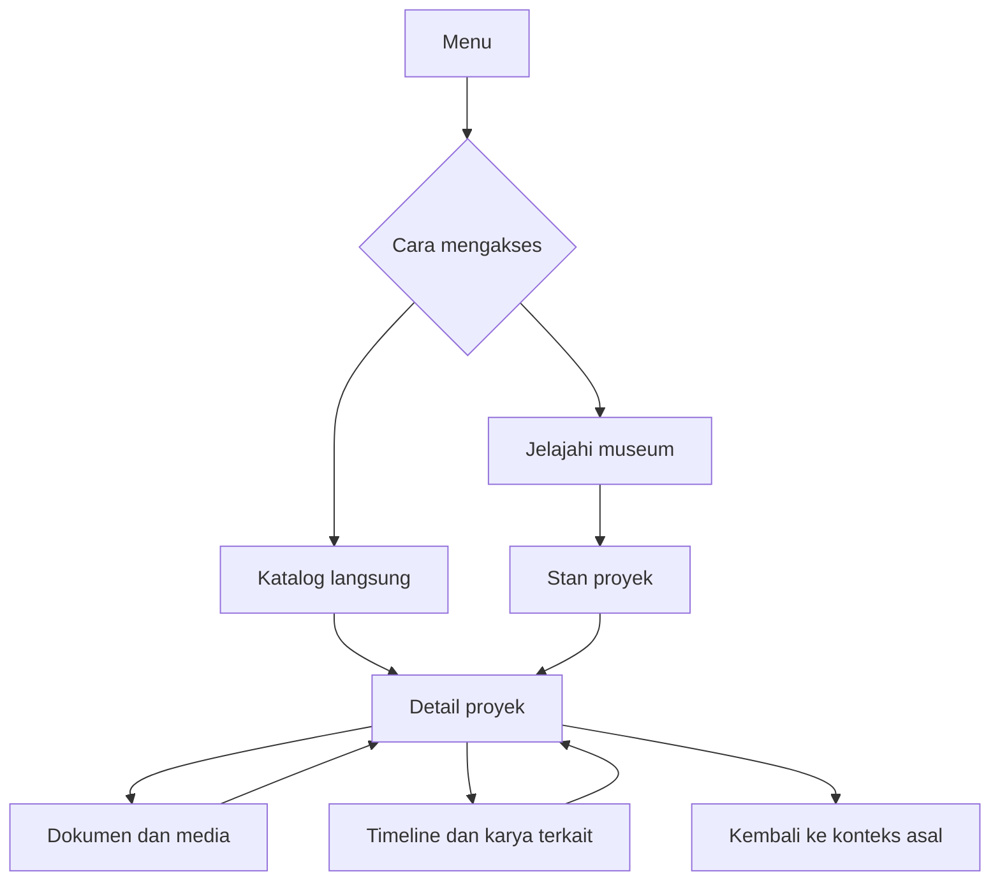
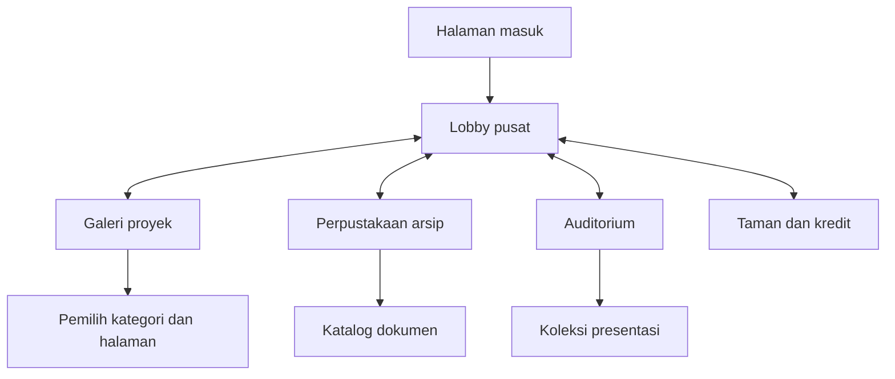
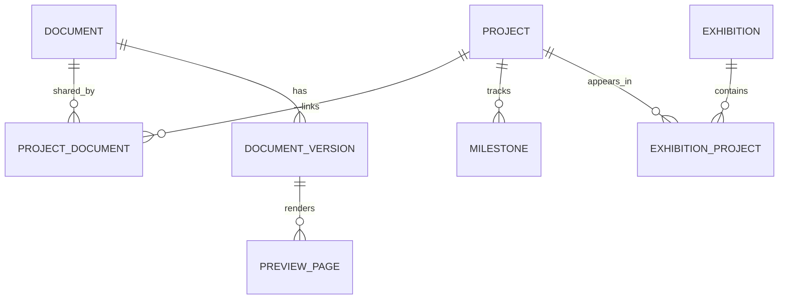
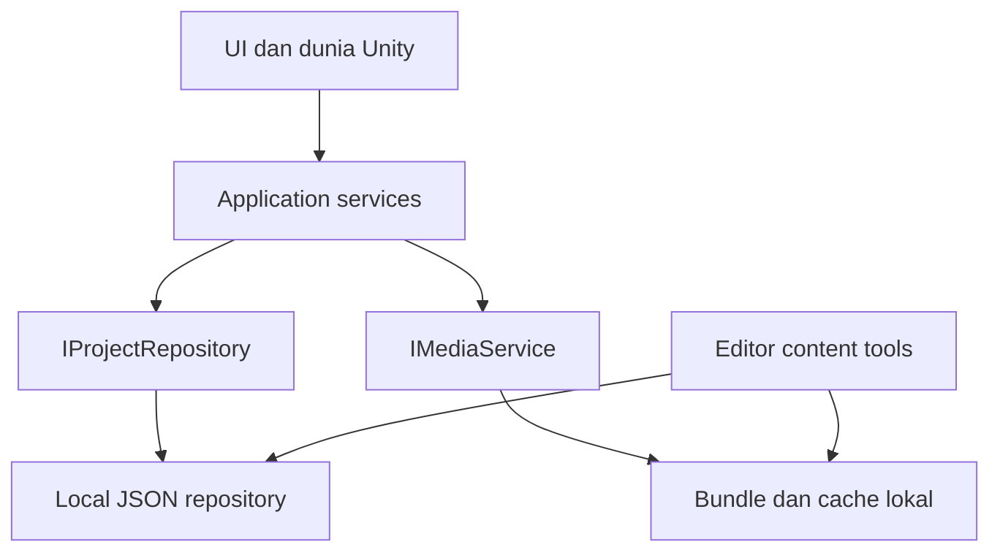
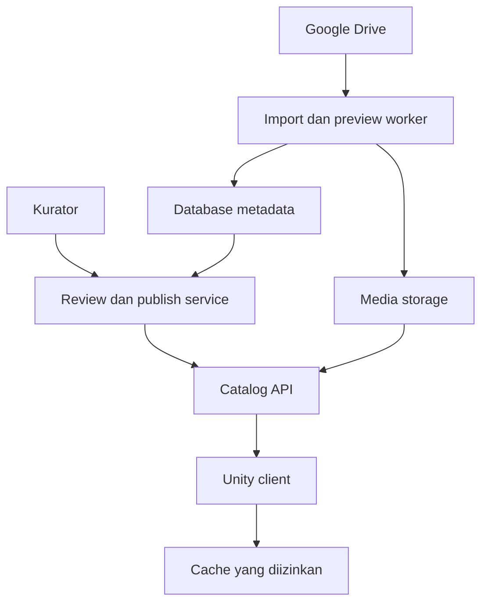

# PROJECT ATLAS — Unity 3D Project Museum

**PRD, Game Design, World Design, Technical Architecture, Content Specification, dan Panduan Implementasi Agent**

| Metadata | Nilai |
|---|---|
| Versi dokumen | 1.0 |
| Tanggal | 10 Oktober 2026 |
| Bahasa produk awal | Bahasa Indonesia |
| Engine | Unity, template Universal 3D / Universal Render Pipeline (URP) |
| Gaya visual | Stylized 3D, terang, bersih, nyaman dilihat |
| Platform prioritas | Windows desktop; Web sebagai fase lanjutan |
| Mode | Single-player exploration, katalog, dokumentasi, dan pameran |
| Nama kerja | PROJECT ATLAS; dapat diganti tanpa mengubah arsitektur |
| Status | Spesifikasi untuk implementasi; bukan laporan aplikasi yang sudah selesai |
| Sumber konten yang diminta | https://drive.google.com/drive/folders/1K0gYFMdzSQlvm8KyYz702XvYIg6pryh_ |

> **PENTING UNTUK AGENT:** Pengguna sudah memakai Unity Universal 3D. Kerjakan di proyek Unity yang tersedia. Jangan mengganti engine menjadi Godot, Unreal, atau aplikasi web biasa. Baca dokumen ini, audit proyek, lalu kerjakan per milestone. Jangan mengklaim fitur sudah bekerja hanya karena script telah dibuat.

> **STATUS DATA:** Isi folder Google Drive belum berhasil dibaca saat dokumen ini disusun. Nama proyek, jumlah file, kategori sebenarnya, format, ukuran, kepemilikan, dan izin publikasi belum terverifikasi. Semua contoh berawalan `sample-` adalah data sintetis. Jangan menyajikannya sebagai proyek asli pengguna. Desain mendukung semua proyek dalam folder; isi nyata dimasukkan setelah inventarisasi dan peninjauan hak akses.

## Daftar isi

1. [Keputusan inti dan asumsi](#1-keputusan-inti-dan-asumsi)
2. [PRD: masalah, tujuan, dan pengguna](#2-prd-masalah-tujuan-dan-pengguna)
3. [Cakupan dan prioritas](#3-cakupan-dan-prioritas)
4. [Kebutuhan fungsional dan acceptance criteria](#4-kebutuhan-fungsional-dan-acceptance-criteria)
5. [Pengalaman bermain dan alur pengguna](#5-pengalaman-bermain-dan-alur-pengguna)
6. [World map dan tata ruang](#6-world-map-dan-tata-ruang)
7. [Spesifikasi desain 3D](#7-spesifikasi-desain-3d)
8. [Asset dan prefab](#8-asset-dan-prefab)
9. [Kontrol, kamera, dan interaksi](#9-kontrol-kamera-dan-interaksi)
10. [UI/UX dan aksesibilitas](#10-uiux-dan-aksesibilitas)
11. [Sistem dokumentasi dan arsip](#11-sistem-dokumentasi-dan-arsip)
12. [Model data dan contoh JSON](#12-model-data-dan-contoh-json)
13. [Integrasi Google Drive](#13-integrasi-google-drive)
14. [Arsitektur aplikasi](#14-arsitektur-aplikasi)
15. [Struktur folder dan assembly Unity](#15-struktur-folder-dan-assembly-unity)
16. [Scene, lifecycle, dan loading](#16-scene-lifecycle-dan-loading)
17. [Kontrak modul dan API](#17-kontrak-modul-dan-api)
18. [Authoring dan pengelolaan konten](#18-authoring-dan-pengelolaan-konten)
19. [Performa dan dukungan platform](#19-performa-dan-dukungan-platform)
20. [Keamanan, akses, dan pemulihan](#20-keamanan-akses-dan-pemulihan)
21. [Roadmap dan backlog](#21-roadmap-dan-backlog)
22. [Koordinasi agent dan aturan repository](#22-koordinasi-agent-dan-aturan-repository)
23. [Pengujian dan Definition of Done](#23-pengujian-dan-definition-of-done)
24. [Risiko, keputusan tertunda, dan handover](#24-risiko-keputusan-tertunda-dan-handover)
25. [Prompt implementasi untuk agent](#25-prompt-implementasi-untuk-agent)
26. [Referensi teknis](#26-referensi-teknis)

## 1. Keputusan inti dan asumsi

### 1.1 Keputusan yang berasal dari pengguna

- Produk menggabungkan dokumentasi PROJECT, pameran, portofolio, dan arsip dalam game 3D.
- Visual menggunakan **Stylized 3D**.
- Cakupan data adalah **semua proyek dalam folder Google Drive** yang diberikan.
- Implementasi menggunakan **Unity Universal 3D / URP**.
- Hasil rancangan harus cukup jelas agar coding agent dapat mengimplementasikannya.

### 1.2 Default rancangan yang boleh disesuaikan

| Keputusan rancangan | Default | Alasan |
|---|---|---|
| Kamera | First-person, tanpa tubuh avatar pada MVP | Fokus membaca karya; mengurangi kebutuhan animasi |
| Platform MVP | Windows x64 | Menuntaskan pengalaman dan media sebelum adaptasi browser |
| Gaya dunia | Museum teknologi modern dengan taman kecil | Menyatukan galeri, arsip, dan presentasi secara masuk akal |
| Struktur dunia | Lobby pusat dan ruang modular | Jumlah proyek dapat bertambah tanpa membangun satu ruang untuk setiap proyek |
| Input | Keyboard + mouse | Cocok untuk desktop dan pameran di laptop |
| UI runtime | uGUI + TextMeshPro | Satu sistem konsisten untuk panel dan label dunia |
| Data MVP | JSON lokal dan media lokal yang disetujui | Pengembangan tidak tergantung akses Drive |
| Integrasi berikutnya | Backend FastAPI + PostgreSQL + penyimpanan media turunan | Menyediakan katalog tervalidasi tanpa kredensial Drive di build |
| Admin MVP | Unity Editor tools / manifest validator | Dashboard web terpisah belum diperlukan |
| Multiplayer, VR, AI guide | Di luar MVP | Tidak diperlukan untuk fungsi dokumentasi inti |

### 1.3 Aturan versi

1. Baca `ProjectSettings/ProjectVersion.txt`, `Packages/manifest.json`, dan `Packages/packages-lock.json`.
2. Catat versi Unity, URP, Input System, dan package yang sudah ada dalam `Docs/PROJECT_AUDIT.md`.
3. Pertahankan versi proyek pengguna. Dokumentasi Unity 6 pada referensi adalah acuan konsep, bukan perintah upgrade.
4. Jangan memasang versi package terbaru secara otomatis. Pilih versi kompatibel dengan Editor yang terpasang.
5. Jika fitur memerlukan upgrade, jelaskan kebutuhan dan dampaknya sebagai keputusan terpisah; milestone lain tetap berjalan.
6. Jangan mengubah pipeline ke HDRP atau Built-in. Verifikasi URP asset terpasang pada Graphics dan setiap Quality tier yang digunakan.

### 1.4 Arti “semua proyek”

Semua proyek yang ditemukan masuk proses inventarisasi. Semua proyek yang lolos kurasi tersedia melalui katalog sesuai hak akses. Dunia 3D menampilkan sebagian stan dalam satu waktu, lalu mengganti kelompok melalui pemilih kategori/halaman. Dengan demikian, cakupan katalog dapat lengkap tanpa memuat ribuan objek dan dokumen sekaligus.

Tidak semua file adalah satu proyek. Satu proyek dapat mempunyai banyak folder, dokumen, gambar, video, dan versi. File yang belum jelas hubungannya masuk antrean **Belum diklasifikasikan**, bukan dibuang atau ditebak.

## 2. PRD: masalah, tujuan, dan pengguna

### 2.1 Masalah produk

Dokumentasi berbasis folder sulit dipresentasikan sebagai cerita proyek. Pengunjung harus berpindah folder untuk memahami masalah, proses, hasil, dan teknologi. Arsip lama juga mudah terlewat ketika fokus hanya pada karya terbaru. Game ini menyediakan konteks visual dan satu katalog terstruktur agar pengunjung dapat menjelajah maupun langsung mencari informasi.

### 2.2 Pernyataan produk

**PROJECT ATLAS adalah museum digital interaktif yang memungkinkan pengunjung menjelajahi proyek dalam dunia 3D, memahami perjalanan pengembangannya, membaca dokumentasi, menonton demo, dan menemukan arsip melalui satu sistem katalog.**

### 2.3 Tujuan yang dapat diuji

| ID | Tujuan | Ukuran keberhasilan awal |
|---|---|---|
| G-01 | Pengunjung memahami proyek | Minimal 4 dari 5 peserta uji dapat menyebutkan masalah dan hasil satu proyek setelah membuka detail |
| G-02 | Informasi mudah ditemukan | Minimal 4 dari 5 peserta menemukan proyek yang ditentukan dalam ≤60 detik lewat pencarian |
| G-03 | Dokumentasi dapat diakses | Semua referensi valid pada fixture rilis dapat dibuka atau memiliki fallback yang jelas |
| G-04 | Konten mudah ditambah | Satu proyek baru tampil melalui perubahan manifest tanpa mengedit scene atau script |
| G-05 | Pameran tetap berjalan tanpa jaringan | Paket offline yang disetujui mendukung lobby, galeri, katalog, dan media terpilih tanpa koneksi |
| G-06 | Data tidak menyesatkan | Setiap proyek memiliki identitas, provenance, status publikasi, dan waktu pembaruan yang jelas |

Angka ini adalah target pengujian produk, bukan hasil yang sudah tercapai. Lima peserta cukup untuk uji kegunaan awal, bukan bukti statistik populasi.

### 2.4 Persona dan hak akses

| Persona | Kebutuhan | Akses |
|---|---|---|
| Pengunjung pameran | Lihat karya dan demo secara cepat | Konten published/public |
| Dosen atau reviewer | Baca proses, progres, bukti, dan hasil | Publik; koleksi terbatas jika diberi akses pada fase backend |
| Pemilik proyek / kurator | Susun metadata, hubungan file, dan urutan pameran | Authoring dan review |
| Administrator | Atur koneksi Drive, sinkronisasi, pengguna, dan publikasi | Operasional backend; bukan menu rahasia dalam build publik |

### 2.5 Prinsip pengalaman

- **Informasi lebih utama daripada dekorasi.** Isi proyek terbaca jelas dalam panel layar.
- **Eksplorasi bersifat pilihan.** Pengunjung dapat membuka katalog tanpa berjalan ke semua stan.
- **Dunia terasa hidup dengan cara sederhana.** Cahaya lembut, tanaman, audio ambient, dan animasi kecil yang tidak mengganggu.
- **Konten nyata terpisah dari demo.** Label contoh terlihat selama data asli belum tersedia.
- **Tidak mengunci informasi lewat permainan.** Tidak ada kewajiban menyelesaikan misi untuk membaca dokumentasi.

## 3. Cakupan dan prioritas

| Tahap | Termasuk | Belum termasuk |
|---|---|---|
| Vertical slice | Lobby, satu galeri 8 slot, movement, interaksi, panel proyek, 3 proyek sintetis | Drive, akun, admin web |
| MVP lokal | Lobby, galeri, arsip, auditorium, pencarian/filter, timeline, bookmark, viewer, paket offline | Sinkronisasi langsung, hak akses privat online |
| Rilis terhubung | Backend, inventaris Drive, kurasi, preview media, publish snapshot, audit | Multiplayer/VR |
| Ekspansi | Web, tur terpandu, kurasi pameran, admin web, analytics opsional | Fitur belum disetujui tidak otomatis dikerjakan |

**P0** berarti harus ada agar tahap terkait diterima. **P1** meningkatkan kenyamanan setelah P0. **P2** adalah pengembangan lanjutan. Satu tahap tidak boleh mengklaim memenuhi P0 tahap lain sebelum implementasinya selesai.

## 4. Kebutuhan fungsional dan acceptance criteria

| ID | Tahap / prioritas | Kebutuhan | Acceptance criteria |
|---|---|---|---|
| FR-01 | Slice / P0 | Bootstrap dan menu | Menjalankan build membuka menu, memilih Jelajahi masuk lobby tanpa error console |
| FR-02 | Slice / P0 | Movement dan kamera | WASD + mouse bekerja; collider mencegah menembus dinding; diagonal tidak lebih cepat |
| FR-03 | Slice / P0 | Interaksi stan | Prompt hanya muncul untuk target terlihat dalam 2,5 m; E membuka proyek yang tepat |
| FR-04 | Slice / P0 | Panel proyek | Judul, ringkasan, masalah, solusi, hasil, tim, dan teknologi tampil dari data |
| FR-05 | MVP / P0 | Katalog seluruh proyek | Semua proyek published yang diizinkan dapat dijangkau lewat paging; tidak bergantung slot stan |
| FR-06 | MVP / P0 | Search dan filter | Cari judul/ringkasan/tag; kombinasi kategori, tahun, dan status menghasilkan irisan yang benar |
| FR-07 | MVP / P0 | Galeri dinamis | Mengubah halaman mengganti binding stan; slot kosong tersembunyi; tidak membuat duplikat |
| FR-08 | MVP / P0 | Viewer gambar | Aspect ratio terjaga; zoom/pan/reset tersedia; gambar rusak menampilkan fallback |
| FR-09 | MVP / P0 | Viewer dokumen | Dokumen yang mempunyai preview dapat dibaca per halaman; tanpa preview ada informasi dan tombol buka sumber |
| FR-10 | MVP / P0 | Pemutar video | Play/pause/seek/volume berfungsi untuk fixture codec target; audio berhenti saat viewer ditutup |
| FR-11 | MVP / P0 | Timeline | Milestone diurutkan tanggal; setiap milestone dapat menautkan bukti; data kosong tidak memunculkan tanggal palsu |
| FR-12 | MVP / P0 | Arsip | Arsip dapat difilter dan dibuka dari katalog; status Archived tidak disamakan dengan terhapus |
| FR-13 | MVP / P0 | Peta dan perjalanan cepat | Tujuan valid memuat ruang dan spawn yang benar; Back to Lobby selalu tersedia |
| FR-14 | MVP / P0 | Offline | Memutus jaringan tidak merusak katalog lokal; media tidak tersedia ditandai secara spesifik |
| FR-15 | MVP / P1 | Bookmark lokal | Bookmark tersimpan antar sesi dengan ID proyek; ID hilang ditampilkan sebagai tidak tersedia |
| FR-16 | MVP / P0 | Pengaturan | Audio, sensitivitas, FOV, kualitas, dan ukuran teks tersimpan serta dapat direset |
| FR-17 | Connected / P0 | Inventaris Drive | Semua halaman hasil diproses; folder anak ditelusuri; file tak terklasifikasi tetap tercatat |
| FR-18 | Connected / P0 | Review sebelum publikasi | Hasil impor menjadi draft; tidak tampil publik sebelum kurator publish |
| FR-19 | Connected / P0 | Sinkronisasi idempotent | Menjalankan sinkronisasi dua kali tanpa perubahan tidak menggandakan file/proyek |
| FR-20 | Connected / P0 | Enforcement akses | Permintaan proyek/media yang tidak berhak ditolak server meskipun ID diketahui |
| FR-21 | Connected / P0 | Snapshot atomik | Katalog baru aktif hanya setelah seluruh validasi lulus; kegagalan mempertahankan versi lama |
| FR-22 | Connected / P1 | Riwayat versi | Revisi sumber dibedakan dari perubahan metadata kurator; versi lama tidak otomatis terekspos |
| FR-23 | Expansion / P1 | Tur terpandu | Pengunjung memilih rute, dapat skip/stop, dan kembali mengendalikan karakter |
| FR-24 | MVP / P0 | Authoring reproducible | Agent dapat menghasilkan scene/prefab melalui Editor tool jika belum tersedia; Play tidak membutuhkan langkah tersembunyi |

## 5. Pengalaman bermain dan alur pengguna

### 5.1 Core loop

Pengunjung masuk museum → melihat penanda kategori → mendekati stan → membuka detail proyek → membaca atau menonton bukti → menyimpan bookmark atau menuju karya terkait → kembali menjelajah.

Tidak ada combat, health, stamina, loot, atau ekonomi. Unsur game berupa eksplorasi, ruang yang menarik, respons interaksi, dan progres kunjungan opsional. Statistik kunjungan tidak menghalangi akses.

### 5.2 Skenario penting

**Eksplorasi pertama:** Menu → tutorial ringkas gerak/lihat/interaksi → lobby → galeri → satu proyek → media → tutup → lanjut berjalan. Tutorial bisa dilewati dan dibuka ulang.

**Mencari dokumen tertentu:** Menu → Katalog → pencarian → Detail Proyek → tab Dokumentasi → filter jenis → viewer. Jalur ini tidak memerlukan navigasi 3D.

**Presentasi:** Menu → Mode Pameran → koleksi yang sudah dikurasi → auditorium → video/detail → kembali koleksi. Mode ini menggunakan konten yang telah disetujui; tidak melewati hak akses.

**Kurasi:** Inventaris → pemetaan proyek → lengkapi metadata → cek preview → cek visibility → publish → katalog baru tersedia. Publikasi adalah tindakan eksplisit kurator.



### 5.3 State aplikasi

`Boot → MainMenu → LoadingZone → Exploring`. Dari Exploring atau MainMenu pengguna dapat membuka Catalog; Catalog dapat membuka ProjectDetail, lalu MediaViewer. Simpan stack konteks agar Back kembali ke posisi scroll dan filter sebelumnya. `ErrorRecoverable` menampilkan pilihan retry/back tanpa menghapus state valid terakhir.

Saat modal terbuka: matikan action map Gameplay, aktifkan UI, lepaskan cursor lock. Saat ditutup: pulihkan action map berdasarkan state asal. Jangan memakai `Time.timeScale = 0` sebagai satu-satunya mekanisme pause karena transisi dan video perlu lifecycle yang jelas.

## 6. World map dan tata ruang

### 6.1 Konsep dunia

Museum satu lantai, terhubung secara logis melalui lobby. Galeri, arsip, auditorium, dan taman mempunyai identitas visual sendiri. Penambahan kategori menggunakan konfigurasi data dan instans ruang galeri, bukan kewajiban membangun gedung baru.



### 6.2 Ukuran dan koneksi

Semua ukuran adalah target blockout, bukan ukuran yang telah diuji. Unity unit = 1 meter. Y ke atas; +Z dianggap utara pada peta. Scene runtime menggunakan origin lokal, sehingga koordinat kampus berikut hanya acuan peta konseptual.

| Zone ID | Ukuran W × D × H | Pusat pada peta konseptual X,Z | Koneksi | Isi |
|---|---|---|---|---|
| `lobby` | 24 × 24 × 7 m | 0,0 | Empat portal berlabel | Resepsionis, direktori, featured project |
| `gallery` | 32 × 24 × 6 m | -36,0 | Pintu timur menuju lobby | 8 stan, pemilih kategori/halaman |
| `archive` | 28 × 24 × 6 m | 34,0 | Pintu barat menuju lobby | Rak dekoratif, 4 terminal, timeline wall |
| `showcase` | 28 × 22 × 7 m | 0,35 | Pintu selatan menuju lobby | Panggung, layar, tempat duduk |
| `courtyard` | 24 × 18 × 5 m area terbuka | 0,-33 | Pintu utara menuju lobby | Taman, bangku, kredit |

Portal adalah transisi scene dengan fade singkat. MVP tidak perlu seamless streaming atau membuat seluruh kampus fisik tanpa loading. Celah antarruang pada peta melambangkan koridor yang tidak perlu dirender seluruhnya.

### 6.3 Lobby

- Spawn lokal `(0, 0.05, -8)`, menghadap +Z; pastikan capsule tidak tumpang tindih collider.
- Meja informasi pusat sekitar `(0, 0, 2)`, ukuran 4 × 1 × 1,1 m.
- Featured pedestal dekat sisi utara tetapi tidak menutup jalur menuju auditorium.
- Galeri di barat, arsip di timur, auditorium di utara, taman di selatan.
- Papan nama ruangan terlihat sebelum pemain mendekati pintu.
- Jalur utama lebar bersih minimal 3 m; tidak ada dekorasi di radius spawn 1,5 m.
- Isi lobby tidak melebihi tiga ajakan utama: Jelajahi Proyek, Cari Dokumentasi, Lihat Presentasi.

### 6.4 Galeri modular

Galeri lokal memiliki batas lantai X ±16 dan Z ±12. Delapan anchor stan berada pada dua baris: X `[-10.5, -3.5, 3.5, 10.5]`, Z `[-6, 6]`. Stan ukuran 5 × 4 m; baris selatan menghadap +Z dan baris utara menghadap -Z. Lorong tengah tetap bebas.

- Spawn dari lobby berada dekat `(14, 0.05, 0)`, menghadap -X.
- Pemilih kategori berada di dekat pintu, tidak menutupi spawn.
- Setiap slot mempunyai ID tetap `slot-01` sampai `slot-08`.
- Urutan pengisian: `sortOrder`, kemudian judul ternormalisasi, kemudian ID untuk tie-break.
- Halaman ke-N berisi proyek indeks `N*8` sampai `N*8+7` setelah filter; N dimulai dari nol.
- Penggantian halaman menutup detail terbuka, membersihkan media lama, dan memperbarui delapan slot yang sama.
- Indikator “9–16 dari 37 proyek” dan tombol Sebelumnya/Berikutnya tersedia.
- Hasil pencarian dapat dibuka langsung. Tombol “Lihat di galeri” menghitung halaman dan anchor, lalu memuat konteks tersebut.

### 6.5 Arsip

Rak adalah representasi kategori/tahun, bukan satu objek buku untuk setiap file. Empat terminal membuka katalog dokumen dengan filter preset: Semua, Laporan, Media, dan Arsip. Label kategori sebenarnya berasal dari data setelah inventaris. Detail file selalu menunjukkan proyek induk dan revisi.

### 6.6 Auditorium

Layar utama lebar 10 m dengan rasio 16:9; panggung 12 × 4 m dan tinggi 0,3 m dengan ramp. Tempat duduk dekoratif menyisakan jalur 3 m. Berinteraksi dengan layar membuka video viewer 2D agar teks dan kontrol terbaca. Satu video aktif; audio dari sumber lain dihentikan selama presentasi.

### 6.7 Taman

Area jeda singkat dengan tanaman stylized, bangku, papan tim dan kredit asset. Tidak memuat gameplay tambahan pada MVP. Dapat ditunda sampai sistem inti berfungsi.

## 7. Spesifikasi desain 3D

Bagian ini merupakan **brief pembuatan asset dan tata ruang**, bukan file model 3D atau render final.

### 7.1 Art direction

Tema: museum teknologi yang hangat dan modern. Gunakan bentuk geometris dengan bevel ringan, proporsi sedikit disederhanakan, material matte, dan warna pastel. Hindari koridor gelap, neon berlebihan, partikel terus-menerus, permukaan seluruhnya metalik, serta label yang menyatu ke tekstur sehingga sulit diganti.

| Peran warna | Hex sRGB | Penggunaan |
|---|---|---|
| Dasar hangat | `#F5F2EA` | Dinding dan bidang besar |
| Putih panel | `#FFFFFF` | Kartu informasi |
| Biru gelap | `#223549` | Teks, frame, outline |
| Teal | `#2F8F91` | Navigasi utama dan galeri |
| Ungu lembut | `#8172C2` | Arsip dan sejarah |
| Jingga lembut | `#ECA35C` | Presentasi dan elemen fokus |
| Hijau sage | `#9BB79B` | Tanaman dan taman |

Warna aksen bukan jaminan kontras teks. Uji pasangan warna pada ukuran nyata; teks kecil memakai biru gelap di latar terang. Status selalu memiliki label/ikon, tidak hanya warna.

### 7.2 Material dan pencahayaan

- URP Lit untuk lingkungan, material opaque sebagai default.
- Gunakan palet material bersama, trim sheet, dan atlas untuk mengurangi variasi material.
- Kaca transparan dibatasi pada aksen kecil; jangan membuat banyak lapisan transparan.
- Satu Directional Light utama; lampu interior baked jika workflow proyek mendukungnya.
- Ambient hangat netral, reflection probe lokal secukupnya, light probes untuk objek dinamis bila diperlukan.
- Post-processing ringan: color adjustment halus; bloom sangat kecil atau mati pada Low.
- Motion blur, depth of field saat membaca, film grain, dan chromatic aberration dinonaktifkan.
- Jangan mengandalkan renderer feature eksperimental untuk highlight MVP; gunakan label, perubahan warna material, atau ring sederhana.

### 7.3 Modul lingkungan

Grid konstruksi 1 m; modul dinding utama 4 m; lantai 4 × 4 m; bevel visual sekitar 0,02–0,08 m sesuai skala. Pivot modul lantai di sudut bawah untuk snapping; pivot prop di tengah dasar. Semua asset memakai skala transform `(1,1,1)` setelah import yang benar.

| Modul | Dimensi awal | Catatan |
|---|---|---|
| Floor tile | 4 × 4 × 0,15 m | Sambungan tidak menimbulkan celah collision |
| Wall | 4 × 0,2 × 4 m | Variant solid dan signage |
| Door frame | Bukaan 3 × 3,2 m | Tidak memerlukan animasi pintu pada MVP |
| Pillar | 0,5 × 0,5 × 4 m | Dekorasi di luar jalur |
| Bench | 2 × 0,6 × 0,45 m | Collider sederhana |
| Plant pot | Diameter 0,5 m | Tanaman tidak perlu collider detail |
| Signboard | 2 × 0,12 × 0,6 m | Teks dinamis, bukan baked texture |

### 7.4 Stand proyek

Setiap stan memiliki base 5 × 4 m, panel belakang tinggi 2,8 m, layar/cover rasio 16:9, label judul maksimal dua baris, satu kalimat ringkasan, badge status, dan prompt interaksi. Detail panjang muncul pada UI layar.

Stan memakai tiga varian visual: **Screen Stand** untuk aplikasi/digital, **Object Pedestal** untuk perangkat/model, dan **Document Stand** untuk penelitian/dokumentasi. Pemilihan berdasarkan `displayType`; belum ada asset khusus menggunakan Screen Stand.

Model 3D interaktif proyek bukan syarat setiap stan. MVP memakai gambar dan prop bawaan. Import model runtime dari Drive adalah fitur terpisah yang memerlukan format, lisensi, ukuran, dan validasi; jangan menganggap Unity otomatis memuat semua FBX/BLEND pada runtime.

### 7.5 Urutan produksi visual

1. Greybox seluruh jalur dan ukuran menggunakan primitive.
2. Uji movement, jarak interaksi, tinggi signage, dan ruang panel.
3. Buat satu stan final sebagai acuan visual.
4. Bangun modular kit dan material bersama.
5. Terapkan pada lobby dan galeri sebelum ruang tambahan.
6. Tambahkan lighting/audio/dekorasi setelah fungsi dan profiling awal stabil.

## 8. Asset dan prefab

### 8.1 Daftar minimum

| Asset / prefab | Jumlah jenis awal | Kewajiban |
|---|---:|---|
| `PF_PlayerRig` | 1 | CharacterController, kamera, input, interaction ray |
| `PF_ProjectStand_*` | 3 | Slot binding, cover, judul, collider interaksi |
| `PF_ZonePortal` | 1 | Target zone dan spawn ID |
| `PF_InfoTerminal` | 1 | Buka katalog dengan preset |
| `PF_DocumentShelf` | 2 | Rak + category link |
| `PF_PresentationScreen` | 1 | Hubungkan presentation item |
| `PF_WayfindingSign` | 1 | Arah, label, warna zona |
| `PF_UIRoot` | 1 | HUD, modal host, toast, loading, EventSystem |
| Modular kit | 8–12 | Lantai, dinding, frame, pilar, plafon |
| Dekorasi | 5–8 | Bangku, tanaman, lampu, papan kredit |

### 8.2 Hierarki prefab stan

```text
PF_ProjectStand_Screen
  VisualRoot
    BaseMesh
    BackPanelMesh
    CoverSurface
    WorldLabels
  InteractionCollider
  FocusAnchor
  MediaAnchor
  ProjectStandController
```

Collider interaksi terpisah dari collision lingkungan. `FocusAnchor` berada di depan panel sekitar tinggi 1,5 m. `ProjectStandController` menerima project ID melalui binding runtime; tidak menyimpan semua isi dokumen di prefab.

### 8.3 Aturan import

- Simpan sumber Blender di `ArtSource/`, export FBX ke `Assets/_Project/Art/Models/`; jangan mewajibkan Blender terpasang pada mesin build Unity.
- Terapkan skala/rotasi sebelum export; cek ukuran aktual menggunakan kubus 1 m.
- Mesh collider kompleks hanya bila perlu; default box/capsule collider.
- Texture kecil untuk dekorasi, maksimum awal 2048 untuk hero asset; screenshot sumber tetap disimpan sebagai media, bukan texture dekorasi.
- Catat pencipta, lisensi, URL sumber, dan modifikasi dalam `Docs/ASSET_LICENSES.md`.
- Jangan mengambil asset berbayar atau logo tanpa hak pakai yang sesuai. Primitive dan asset buatan sendiri cukup untuk slice.

## 9. Kontrol, kamera, dan interaksi

| Input default | Fungsi |
|---|---|
| W/A/S/D | Bergerak |
| Mouse | Melihat |
| Shift | Berjalan cepat; opsi, tanpa stamina |
| E | Interaksi target |
| Tab | Katalog |
| M | Peta |
| Esc | Tutup modal teratas / menu pause |
| Klik kiri | Tombol UI |
| Scroll | Scroll UI atau zoom pada viewer, sesuai fokus |

Kecepatan normal awal 3,5 m/s, cepat 5,5 m/s; capsule tinggi 1,8 m, radius 0,3 m; tinggi kamera 1,65 m; pitch dibatasi ±80°. FOV awal 65°, opsi 55–90°. Angka ini tuning awal. Head bob mati secara default; tidak ada jump pada MVP.

Ray interaksi berasal dari kamera, jarak maksimum 2,5 m, memakai layer mask khusus. Uji occlusion dengan dinding: jangan menargetkan objek di balik tembok. Satu target aktif; prompt hilang saat tidak valid. Semua interaksi memanggil interface yang sama.

State target: `None → Focused → Interacting → Released`. State modal lebih tinggi prioritasnya daripada gameplay. Saat kehilangan fokus aplikasi atau pointer lock, hentikan look/movement sampai fokus dipulihkan secara sengaja. Tombol “Kembali ke Lobby” memulihkan pengguna yang tersangkut.

## 10. UI/UX dan aksesibilitas

### 10.1 Daftar layar

| Layar | Komponen |
|---|---|
| Main Menu | Jelajahi, Katalog, Mode Pameran, Pengaturan, Keluar pada desktop |
| HUD | Crosshair kecil, nama zona, prompt E, tombol bantuan |
| Map | Kartu zona, lokasi aktif, akses cepat |
| Catalog | Search, filter, jumlah hasil, grid/list, paging |
| Project Detail | Cover, judul, status, tab, bookmark, karya terkait |
| Media Viewer | Judul file, controls, metadata sumber, tutup/kembali |
| Settings | Audio, input, visual, UI scale, reset |
| Empty / Error | Alasan singkat, retry atau kembali yang relevan |

### 10.2 Layout detail proyek

Pada 1920 × 1080, modal maksimal sekitar 1440 × 900 px, margin aman minimal 48 px; ukuran menyesuaikan layar melalui Canvas Scaler. Kolom kiri sekitar 30% untuk cover dan metadata; kanan 70% untuk isi. Pada resolusi sempit gunakan susunan vertikal. Jangan hardcode resolusi layar.

Tab:

1. **Ringkasan:** masalah, solusi, fitur, hasil, peran tim, status.
2. **Dokumentasi:** file dan filter tipe; tampilkan tanggal, ukuran bila diketahui, dan versi.
3. **Galeri:** screenshot/foto dengan caption.
4. **Demo:** video dan tautan demo yang telah disetujui.
5. **Timeline:** milestone dan evidence.
6. **Teknologi:** stack dengan nama teks; logo opsional.

Isi kosong memakai “Belum tersedia”, bukan teks promosi karangan. Tombol tidak tersedia menjelaskan alasannya. Judul panjang di kartu dipotong dengan ellipsis; judul lengkap tersedia di panel.

### 10.3 Gaya dan aksesibilitas

- Body text awal 22–24 px pada acuan 1080p; heading 32–40 px; UI scale 100–150%.
- Ukuran klik minimum rancangan 44 × 44 px pada skala acuan.
- Focus keyboard terlihat; modal memiliki fokus awal dan mengembalikannya saat ditutup.
- Subtitle/caption jika disediakan; audio bukan satu-satunya pembawa informasi.
- Reduce Motion mematikan animasi kamera otomatis, zoom dekoratif, dan fade panjang.
- Katalog langsung menjadi alternatif bagi pengguna yang tidak nyaman bergerak first-person.
- Jangan mengklaim kepatuhan aksesibilitas penuh sebelum audit, termasuk dukungan screen reader yang memerlukan pekerjaan tersendiri.

### 10.4 State konten

`Loading`, `Ready`, `Empty`, `OfflineUnavailable`, `Forbidden`, `NotFound`, dan `Failed` dibedakan. Contoh: “File ini belum tersedia offline” berbeda dari “Anda tidak memiliki akses”. Pesan tidak boleh membocorkan judul file privat kepada pengguna tanpa izin.

## 11. Sistem dokumentasi dan arsip

### 11.1 Lapisan informasi

1. **Project:** identitas karya dan narasi.
2. **Document:** identitas logis dokumen, misalnya Laporan Progres.
3. **DocumentVersion:** revisi tertentu dengan sumber dan preview yang sesuai.
4. **Media:** cover, gambar, video, dan preview dokumen.
5. **Milestone:** kejadian proyek beserta bukti.
6. **Exhibition:** kumpulan proyek dan urutan presentasi.

`developmentStatus` (`planned`, `in_progress`, `completed`, `archived`) terpisah dari `publicationState` (`draft`, `review`, `published`, `withdrawn`). Proyek archived tetap dapat dipublikasikan untuk kebutuhan sejarah.

### 11.2 Dukungan format

| Jenis sumber | MVP | Connected / lanjutan |
|---|---|---|
| PNG/JPEG | Viewer gambar lokal | Thumbnail dan gambar optimasi |
| PDF | Halaman PNG/JPEG yang sudah disiapkan, plus tautan sumber | Worker menghasilkan preview halaman; PDF asli sebagai unduhan terkontrol |
| DOCX/PPTX/XLSX | Metadata + buka sumber; preview hanya jika tersedia | Konversi terisolasi ke PDF/halaman bila didukung; tampilkan status gagal |
| Google Docs/Slides/Sheets | Tautan sumber yang disetujui | Export format yang tersedia, lalu pipeline preview |
| MP4 | Uji H.264/AAC pada target Windows | Transcode ke profil yang diuji; Web memerlukan uji browser/CORS |
| ZIP/source code | Metadata dan tautan download jika diizinkan | Tetap tidak dieksekusi dalam game |
| FBX/BLEND/GLB | Metadata dan thumbnail | 3D viewer khusus hanya setelah format/runtime loader dipilih dan diuji |
| Format lain | File card dengan keterangan unsupported | Adapter terpisah sesuai kebutuhan nyata |

Unity tidak diasumsikan memiliki pembaca PDF/Office lengkap bawaan. Viewer halaman gambar adalah keputusan MVP agar implementasi terukur. Dokumen besar dimuat per halaman; jangan decode seluruh dokumen menjadi texture sekaligus.

### 11.3 Penelusuran dan filter

Pencarian MVP case-insensitive pada judul, ringkasan, nama anggota jika publik, kategori, dan tag. Normalisasi Unicode dan whitespace. Jangan mengklaim pencarian full-text isi PDF sebelum indexing dibuat. Relevansi awal: kecocokan judul tepat, awalan judul, kata di judul, kemudian metadata lain; urutan stabil berdasarkan ID.

Filter dalam kategori yang sama bersifat OR; antarjenis filter bersifat AND. Filter tahun menggunakan `year`, bukan menebak dari waktu upload. Reset filter tersedia; tampilkan jumlah hasil. Untuk katalog lokal awal, fixture 100 proyek dan 1.000 file dipakai sebagai beban uji, bukan estimasi isi Drive sebenarnya.

### 11.4 Versi dan provenance

Setiap file menyimpan provider ID, MIME, waktu sumber dimodifikasi, waktu impor, checksum jika tersedia, dan versi internal. Nama file bukan primary key. Tautan sumber, metadata, dan preview harus merujuk revisi yang sama. Preview lama tidak dipasangkan dengan label versi baru sebelum konversi selesai.

Histori revisi Drive tidak dianggap arsip permanen otomatis. Jika retensi versi wajib, backend menyimpan snapshot yang diizinkan beserta kebijakan retensinya. Mengarsip proyek tidak berarti menghapus sumber Drive.

## 12. Model data dan contoh JSON

### 12.1 Entitas utama

| Entitas | Field pokok | Relasi / aturan |
|---|---|---|
| Project | id, slug, title, summary, year, developmentStatus, publicationState, visibility | ID stabil; slug dapat berubah dengan redirect |
| ProjectDetail | problem, solution, outcomes, features, team, techStack | Teks informatif; field tidak diketahui tidak dikarang |
| Category | id, label, sortOrder | Kategori tentatif diganti setelah inventaris |
| ProjectCategory | projectId, categoryId | Mendukung lebih dari satu kategori |
| Document | id, title, currentVersionId | Identitas logis dokumen |
| ProjectDocument | projectId, documentId, role | Satu file bersama dapat terkait beberapa proyek |
| DocumentVersion | id, documentId, sourceRef, modifiedAt, previewMediaIds | Versi internal immutable |
| Media | id, kind, locator, checksum, contentType, width, height, byteSize | Dimensi/ukuran nullable jika belum diketahui |
| Milestone | id, projectId, date, title, description, evidenceDocumentIds | Tanggal ISO; urutan deterministik |
| Exhibition | id, title, projectIds, presentationMediaIds | Koleksi terkurasi |
| Publication | catalogVersion, schemaVersion, publishedAt, manifestChecksum | Snapshot katalog tervalidasi |
| ImportRecord | providerFileId, parentIds, importState, errorCode | Tidak hilang saat belum terklasifikasi |
| AccessPolicy | resourceId, audience, grants | Ditegakkan server pada fase connected |



### 12.2 Contoh katalog offline

Contoh berikut valid secara sintaks JSON. Semua ID dan konten proyek adalah sintetis. File media yang dirujuk harus dibuat agent sebagai fixture sebelum dipakai; contoh JSON saja tidak menyediakan byte gambarnya.

```json
{
  "schemaVersion": 1,
  "catalogVersion": "sample-2026-10-10-001",
  "publishedAt": "2026-10-10T08:00:00Z",
  "isSample": true,
  "categories": [
    { "id": "sample-digital", "label": "Contoh Karya Digital", "sortOrder": 10 }
  ],
  "projects": [
    {
      "id": "sample-project-001",
      "slug": "contoh-proyek-digital",
      "title": "Contoh Proyek Digital",
      "summary": "Data sintetis untuk menguji alur museum.",
      "year": 2026,
      "developmentStatus": "in_progress",
      "publicationState": "published",
      "visibility": "public",
      "categoryIds": ["sample-digital"],
      "tags": ["contoh", "prototype"],
      "problem": "Contoh kebutuhan pencatatan informasi.",
      "solution": "Contoh aplikasi pencatatan terstruktur.",
      "outcomes": ["Prototype contoh; bukan capaian proyek pengguna."],
      "features": ["Daftar informasi", "Pencarian"],
      "team": [{ "displayName": "Tim Contoh", "role": "Developer" }],
      "techStack": ["Unity", "C#"],
      "coverMediaId": "sample-cover-001",
      "galleryMediaIds": [],
      "demoMediaIds": [],
      "documentIds": ["sample-doc-001"],
      "relatedProjectIds": [],
      "displayType": "screen",
      "sortOrder": 10,
      "updatedAt": "2026-10-10T08:00:00Z",
      "isSample": true
    }
  ],
  "documents": [
    {
      "id": "sample-doc-001",
      "title": "Laporan Contoh",
      "currentVersionId": "sample-docver-001"
    }
  ],
  "documentVersions": [
    {
      "id": "sample-docver-001",
      "documentId": "sample-doc-001",
      "versionLabel": "v1",
      "mimeType": "application/pdf",
      "sourceRef": { "provider": "fixture", "fileId": "sample-source-001", "webUrl": null },
      "modifiedAt": "2026-10-10T08:00:00Z",
      "previewMediaIds": ["sample-page-001"],
      "previewState": "ready"
    }
  ],
  "media": [
    {
      "id": "sample-cover-001",
      "kind": "image",
      "locator": { "type": "bundle", "path": "Media/sample-cover-001.png" },
      "contentType": "image/png",
      "checksum": null,
      "width": 1280,
      "height": 720,
      "byteSize": null,
      "offlineAllowed": true
    },
    {
      "id": "sample-page-001",
      "kind": "document_page",
      "locator": { "type": "bundle", "path": "Media/sample-page-001.png" },
      "contentType": "image/png",
      "checksum": null,
      "width": 1240,
      "height": 1754,
      "byteSize": null,
      "offlineAllowed": true
    }
  ],
  "milestones": [
    {
      "id": "sample-milestone-001",
      "projectId": "sample-project-001",
      "date": "2026-10-10",
      "title": "Prototype contoh",
      "description": "Milestone sintetis untuk pengujian timeline.",
      "evidenceDocumentIds": ["sample-doc-001"]
    }
  ],
  "exhibitions": [
    {
      "id": "sample-exhibition-001",
      "title": "Pameran Contoh",
      "projectIds": ["sample-project-001"],
      "presentationMediaIds": []
    }
  ]
}
```

### 12.3 Validasi wajib

- ID unik per entitas; semua foreign key harus resolve.
- Schema version yang belum didukung ditolak dengan pesan kompatibilitas.
- Public snapshot hanya mengandung proyek dan media yang diizinkan; menyembunyikan tombol saja tidak cukup.
- Path bundle relatif, tidak boleh absolute, `..`, atau keluar direktori paket.
- URL sumber HTTPS dan domain yang disetujui; jangan mengizinkan `javascript:`, `file:`, atau command lokal.
- Jumlah halaman, ukuran gambar/video, dan panjang teks mempunyai batas konfigurasi untuk mencegah alokasi tidak terkendali.
- Metadata nullable ditampilkan sebagai belum diketahui, bukan nol yang menyesatkan.
- `publicationState=published` memerlukan title, summary, kategori valid, dan review visibility.
- Contoh `checksum=null` hanya untuk fixture; paket produksi menghitung SHA-256 media dan manifest.

## 13. Integrasi Google Drive

### 13.1 Batas integrasi

Drive adalah sumber dokumen. Unity membaca katalog terkurasi dari backend atau paket offline. Kredensial OAuth/service account tetap di server; jangan memasukkannya ke `Resources`, `StreamingAssets`, ScriptableObject, source control, atau build.

Untuk folder personal, OAuth pemilik adalah opsi awal. Service account hanya dipakai jika folder memang dibagikan dan konfigurasi mengizinkannya. Pilih scope minimum yang benar-benar dapat mengakses kumpulan sumber yang dipilih; jangan menganggap scope per-file otomatis membuka semua isi folder yang sudah ada.

### 13.2 Inventaris awal

1. Validasi akses ke root folder dengan identitas yang disetujui.
2. Ambil child file/folder melalui query parent dan pagination; lanjutkan sampai token halaman habis.
3. Telusuri folder secara rekursif; simpan visited IDs untuk mencegah pengulangan.
4. Catat file ID, parents, name, MIME, modified time, ukuran/checksum bila tersedia, dan metadata akses yang diperlukan.
5. Shortcut tidak otomatis diikuti keluar root. Tandai untuk review; jika diizinkan, resolve target dan tetap cegah siklus.
6. Folder proyek tidak ditentukan dari nama saja. Gunakan mapping kurator `source folder IDs → project IDs`.
7. File bersama dapat ditautkan ke beberapa proyek tanpa menyalin byte sumber.
8. Hasil pemindaian disimpan sebagai inventaris draft, termasuk unsupported dan unclassified.
9. Buat laporan jumlah discovered, mapped, unclassified, excluded, failed; jumlah kategori tersebut harus dapat direkonsiliasi.

Panduan resmi pencarian Drive menjelaskan query file/folder dan filter parent [R5]. Strategi rekursi, pemetaan, dan kurasi di atas adalah desain aplikasi ini.

### 13.3 Download, export, dan preview

Drive membedakan unduhan file biner dan export dokumen Google Workspace [R4]. Backend memilih operasi sesuai MIME dan memeriksa batas export provider saat implementasi. Jangan menggunakan URL halaman Drive sebagai URL video/gambar mentah.

Worker membuat thumbnail, preview halaman, dan video optimasi. Simpan original secara terpisah jika hak penyimpanan mengizinkan. Hasil konversi menyertakan versi sumber dan status `queued`, `processing`, `ready`, `failed`, atau `unsupported`. Konversi dijalankan dengan batas waktu, memori, ukuran, dan isolasi proses.

### 13.4 Sinkronisasi lanjutan

Gunakan cursor perubahan Drive setelah inventaris awal, dengan mekanisme pemulihan dan reconciliation berkala [R6]. Change feed bukan daftar subtree siap pakai: backend harus memeriksa perubahan parent/membership, shortcut, izin, dan pemindahan folder. Polling metadata rekursif dapat menjadi implementasi awal yang lebih sederhana bila skala kecil.

- Upsert berdasarkan provider + file ID, bukan nama.
- Rename mempertahankan mapping; pemindahan ditinjau ulang terhadap root scope.
- Perubahan isi membuat versi internal baru dan mengantrekan ulang preview.
- `429`/gangguan sementara menggunakan retry terbatas dengan exponential backoff dan jitter.
- `401`/`403` memerlukan penanganan otorisasi; jangan retry tanpa batas.
- Satu scan gagal tidak dianggap bukti file terhapus. Beri status uncertain sampai terkonfirmasi.
- Revocation/withdrawal memblokir akses server dan memicu invalidasi cache terkait; penghapusan byte mengikuti kebijakan retensi.
- Publish snapshot baru hanya setelah validasi dan review, bukan setiap perubahan file.

### 13.5 Checklist pemetaan konten asli

Kurator mengisi nama resmi proyek, deskripsi, kategori, tahun, status, tim, cover, file terkait, milestone yang mempunyai bukti, visibility, dan izin offline. Jangan memakai nama proyek dari percakapan lain sebagai isi folder tanpa bukti sumber.

## 14. Arsitektur aplikasi

### 14.1 Tahap MVP lokal



### 14.2 Tahap connected



### 14.3 Batas tanggung jawab

| Lapisan | Tanggung jawab | Hindari |
|---|---|---|
| Domain | Model, filter, validasi, status | Referensi scene dan networking |
| Application | Use case cari/buka proyek, navigasi, permission state | Membaca file Drive langsung |
| Infrastructure | JSON, HTTP, cache, serialization | Mengendalikan input pemain |
| Presentation | UI, stan, media presentation | Menentukan akses hanya dari UI |
| Editor | Scene builder, authoring, validator | Terikut dalam runtime build |
| Backend | Auth, catalog API, publish, audit | Rendering dunia Unity |
| Worker | Import, export, preview, integrity | Menyimpan token dalam output publik |

Gunakan constructor injection untuk kelas C# biasa dan serialized references/composition root untuk MonoBehaviour. Tidak wajib memasang DI framework. Hindari satu `GameManager` raksasa yang menangani seluruh fungsi.

## 15. Struktur folder dan assembly Unity

Struktur berikut adalah target; jika proyek yang ada sudah rapi, petakan ke struktur tersebut tanpa memindahkan semuanya secara destruktif.

```text
<repository>/
  Assets/
    _Project/
      Scenes/
        Bootstrap.unity
        Frontend.unity
        Lobby.unity
        Gallery.unity
        Archive.unity
        Showcase.unity
        Courtyard.unity
      Scripts/
        Domain/               Models, validation, filtering
        Application/          Use cases and interfaces
        Infrastructure/       Local/remote repositories, cache
        Runtime/              Bootstrap, player, zones, composition
        Presentation/         UI, stands, viewers
        Editor/               Builders, authoring, validation
      Prefabs/
        Player/
        Environment/
        Exhibits/
        UI/
      Art/
        Models/
        Materials/
        Textures/
        Lighting/
      Audio/
      UI/
        Fonts/
        Icons/
        Sprites/
      Settings/
        Input/
        Rendering/
        Zones/
        Themes/
      Tests/
        EditMode/
        PlayMode/
    StreamingAssets/
      Catalog/catalog.json
      Media/
  Packages/
  ProjectSettings/
  ArtSource/
  ContentSource/
  Backend/                    Dibuat saat milestone connected
  Docs/
    PROJECT_AUDIT.md
    ARCHITECTURE_DECISIONS.md
    CONTENT_INVENTORY.md
    TASK_BOARD.md
    CHANGELOG.md
    TEST_REPORT.md
    ASSET_LICENSES.md
    BUILD_AND_RUN.md
  UNITY_3D_PROJECT_MUSEUM_MASTER_SPEC.md
  AGENTS.md                   Dibuat/digabung saat implementasi
```

### 15.1 Dependency assembly

| Assembly | Referensi |
|---|---|
| `Atlas.Domain` | .NET yang didukung; tanpa UnityEngine jika memungkinkan |
| `Atlas.Application` | Domain |
| `Atlas.Infrastructure` | Domain, Application, Unity networking sesuai adapter |
| `Atlas.Presentation` | Domain, Application, Unity UI |
| `Atlas.Runtime` | Application, Infrastructure, Presentation; composition root |
| `Atlas.Editor` | Runtime dan modul authoring; platform Editor only |
| `Atlas.Tests.*` | Assembly yang diuji dan Unity Test Framework kompatibel |

Jangan membuat circular reference. Jika tipe kontrak dibutuhkan beberapa assembly, pindahkan kontraknya ke Application, bukan menambah referensi silang.

### 15.2 Konvensi

- Namespace `ProjectAtlas.<Module>`; class PascalCase, private field `_camelCase`.
- Prefix asset: `PF_`, `MAT_`, `TEX_`, `SO_`, `SFX_`; scene menggunakan nama pada tabel.
- Simpan `.meta` bersama asset; pindahkan asset melalui Unity/AssetDatabase bila memungkinkan.
- Jangan menyimpan data proyek panjang dalam source code atau scene YAML.
- ScriptableObject untuk konfigurasi dunia/theme; JSON/API untuk isi proyek dinamis.
- Serialization harus mendukung schema JSON yang dipilih secara eksplisit. Jika memakai `JsonUtility`, buat DTO serializable berbasis field/list dan uji null/enum; jangan menganggap dictionary/properties bekerja otomatis.

## 16. Scene, lifecycle, dan loading

### 16.1 Kepemilikan scene

| Scene | Tanggung jawab |
|---|---|
| Bootstrap | Composition root, services, global UI, player rig, satu EventSystem |
| Frontend | Lingkungan menu opsional; tidak membuat service global kedua |
| Lobby | Geometri lobby, spawn anchors, portal, terminal |
| Gallery | Geometri galeri, delapan slot, selector |
| Archive | Geometri arsip dan terminal preset |
| Showcase | Geometri auditorium dan presentasi |
| Courtyard | Geometri taman dan kredit |

Bootstrap tetap loaded; satu scene zona aktif dimuat additive melalui `LoadSceneAsync`. Unity menyediakan loading asynchronous dan mode additive [R2]. Pola satu zona aktif adalah keputusan desain untuk membatasi memori, bukan aturan wajib Unity.

### 16.2 Prosedur transisi

1. Kunci permintaan transisi ganda; catat tujuan dan spawn ID.
2. Tutup modal, hentikan media, nonaktifkan input gameplay, tampilkan fade/loading.
3. Muat scene tujuan asynchronous; biarkan scene lama tersedia sampai tujuan tervalidasi.
4. Temukan ZoneRoot dan spawn; jika tidak valid, unload tujuan dan pulihkan scene lama.
5. Tetapkan active scene, atur environment/lighting sesuai zona, pindahkan rig dengan CharacterController sementara dinonaktifkan.
6. Unload zona lama dan lepaskan subscription serta asset reference yang tidak dipakai.
7. Aktifkan input dan fade-in. Catat transisi selesai hanya setelah spawn valid.

Loading progress UI tidak boleh mengklaim persentase unduhan yang tidak diukur. Gunakan status “Memuat ruangan” bila progres total tidak tersedia.

### 16.3 Reset dan cleanup

Player/global UI hanya satu instance. Hindari kombinasi scene persistent dan `DontDestroyOnLoad` yang menghasilkan duplikasi. Setiap subscriber melepas event saat disable/dispose. Texture cache memiliki ownership dan batas ukuran; release texture setelah tidak lagi digunakan. VideoPlayer dihentikan dan target RenderTexture dilepas saat keluar viewer/ruang.

## 17. Kontrak modul dan API

### 17.1 Komponen utama

| Komponen | Tanggung jawab |
|---|---|
| `AppBootstrapper` | Validasi config dan compose services |
| `AppStateController` | State aplikasi dan modal stack |
| `PlayerMotor` / `PlayerLook` | Gerak dan kamera |
| `InteractionController` | Raycast, fokus, invoke target |
| `ZoneLoader` | Transisi scene dan spawn |
| `GalleryPresenter` | Pemetaan filter/page ke delapan slot |
| `ProjectDetailPresenter` | Binding data ke tab detail |
| `CatalogService` | Query, filter, sort, dan akses repository |
| `MediaService` | Resolve, load, cache, cancel, release |
| `BookmarkService` | Bookmark lokal per profil perangkat |
| `SettingsService` | Settings versioned dan reset |
| `ContentValidator` | Schema, relasi, paths, dan publish rules |

### 17.2 Bentuk kontrak C#

Contoh berikut adalah **kontrak rancangan**, bukan script siap compile. Agent harus mendefinisikan tipe hasil, cancellation, error handling, dan implementasi sesuai versi proyek.

```csharp
public interface IInteractable
{
    string Prompt { get; }
    bool CanInteract(InteractionContext context);
    void Interact(InteractionContext context);
}

public interface IProjectRepository
{
    Task<ProjectPage> SearchAsync(ProjectQuery query, CancellationToken ct);
    Task<ProjectDetail> GetByIdAsync(string projectId, CancellationToken ct);
}

public interface IMediaService
{
    Task<MediaLease> AcquireAsync(string mediaId, CancellationToken ct);
}

public interface IZoneNavigator
{
    Task NavigateAsync(ZoneDestination destination, CancellationToken ct);
}
```

`MediaLease` harus mempunyai release/dispose yang jelas; tidak boleh membocorkan texture setiap modal dibuka. UI cancel request ketika panel ditutup dan mengabaikan hasil request lama agar cover proyek sebelumnya tidak menimpa proyek baru. Semua operasi Unity object dijalankan pada main thread; Task tidak berarti bebas menyentuh Unity API dari worker thread.

### 17.3 API fase connected

| Metode / endpoint | Fungsi | Akses |
|---|---|---|
| `GET /v1/catalog/version` | Versi snapshot dan schema | Sesuai audience |
| `GET /v1/projects?q=&category=&year=&status=&cursor=&limit=` | Katalog paginated | Server menyaring akses |
| `GET /v1/projects/{id}` | Detail proyek | Sesuai policy |
| `GET /v1/projects/{id}/documents` | Dokumen proyek | Sesuai policy |
| `GET /v1/documents/{id}/versions` | Versi yang boleh dilihat | Sesuai policy |
| `GET /v1/media/{id}/access` | Resolve lokasi stream/download | Validasi resource permission |
| `GET /v1/exhibitions/{id}` | Koleksi pameran | Sesuai audience |
| `POST /v1/admin/import-jobs` | Buat job inventaris | Admin |
| `GET /v1/admin/import-jobs/{id}` | Progres/ringkasan job | Admin |
| `PATCH /v1/admin/projects/{id}` | Edit kurasi | Kurator, optimistic concurrency |
| `POST /v1/admin/publications` | Publish snapshot tervalidasi | Publisher role |

API mengembalikan `items`, `nextCursor`, dan `catalogVersion`; limit awal 24, maksimum 100. Cursor terikat pada snapshot agar paging tidak berubah di tengah sesi. Catalog version berubah → UI menawarkan refresh atau mulai ulang query secara konsisten. Error envelope berisi `code`, `message`, `requestId`; detail internal hanya di log server.

Gunakan `401` untuk autentikasi diperlukan, `403` untuk izin ditolak bila aman diungkapkan, `404` untuk resource tidak ditemukan/tidak boleh diketahui, `409` untuk revisi konflik, `422` untuk data invalid, `429` untuk rate limit, `503` untuk gangguan sementara. Jangan retry operasi publikasi secara buta; gunakan idempotency key untuk job/publish.

## 18. Authoring dan pengelolaan konten

### 18.1 Editor tools MVP

Menu rancangan:

- `Tools/Project Atlas/Audit Project`
- `Tools/Project Atlas/Create Sample Content`
- `Tools/Project Atlas/Build Starter Scenes`
- `Tools/Project Atlas/Validate Catalog`
- `Tools/Project Atlas/Build Offline Package`

Builder harus idempotent: menjalankan ulang tidak membuat scene, material, EventSystem, atau rig duplikat. Jika target sudah ada dan dimodifikasi pengguna, tawarkan regenerate ke folder output baru atau update terkontrol; jangan menghapus konten yang tidak dimiliki builder.

Gunakan Unity Editor API untuk membuat scene dan prefab. Jangan menulis YAML scene/prefab besar secara manual lalu menganggap referensi GUID valid. Jika agent tidak dapat menjalankan Unity, ia tetap membuat script builder dan instruksi langkah manual, lalu menandai compile/play/build sebagai belum diuji.

### 18.2 Workflow satu proyek

Tambahkan project record → tautkan file → isi metadata minimum → siapkan cover → validasi → preview di Editor → pilih audience/offline policy → publish/export paket. Penambahan data tidak mengharuskan penambahan prefab atau scene baru.

### 18.3 Admin connected

Pada tahap awal backend, admin dapat berupa CLI terautentikasi atau halaman internal minimal. Dashboard web lengkap menjadi P1: inventaris, mapping, edit metadata, preview, status import, pengaturan audience, publish history. CRUD publik tanpa otorisasi tidak diperbolehkan.

## 19. Performa dan dukungan platform

### 19.1 Target awal, belum hasil benchmark

Baseline uji provisional: Windows 10/11 x64, RAM 8 GB, SSD, GPU terintegrasi sekelas Intel Iris Xe atau perangkat nyata setara yang ditetapkan saat M0. Jika laptop pengguna berbeda, rekam hardware dan revisi budget berdasarkan profiling; jangan menjanjikan 60 FPS di semua laptop.

| Metrik | Target awal |
|---|---|
| Desktop Medium, 1080p | Median ≥60 FPS, p95 frame time ≤25 ms pada tur uji 2 menit setelah warm-up |
| Desktop Low, 720p | Median ≥30 FPS, p95 frame time ≤40 ms |
| Memori proses desktop | Peak sekitar ≤1,5 GB untuk fixture; ukur sebenarnya |
| Waktu masuk lobby lokal | ≤8 detik pada baseline setelah build dimulai |
| Transisi zona lokal | ≤3 detik setelah warm-up |
| Search metadata lokal | p95 ≤200 ms pada 100 proyek / 1.000 file fixture |
| Scene aktif | Bootstrap + satu zona; overlap dua zona hanya saat transisi |
| Video aktif | Maksimum 1 decoder/video playback |
| Stand aktif | 8 slot galeri, plus featured lobby bila lobby aktif |

Catat build type, resolusi, quality, hardware, durasi, median/p95, dan peak memory dalam laporan. Ukur standalone build dengan Profiler/alat platform yang sesuai; jangan menyimpulkan performa rilis hanya dari Editor.

### 19.2 Budget visual awal

Visible geometry target awal sekitar 300 ribu triangle pada Medium dan 150 ribu pada Low; draw/batch count sekitar ≤150 sebagai alarm profiling awal, bukan jaminan bottleneck. Texture cache decoded awal 128 MB; satu gambar 2048² RGBA dapat memakai sekitar 16 MB sebelum mip/overhead, sehingga ukuran file terkompresi bukan ukuran RAM.

Thumbnail dimuat dulu, gambar besar saat viewer dibuka. Batasi request media bersamaan, awal 4. Gunakan cache LRU dengan lease/reference count; asset yang masih dipakai tidak dievict. Material bersama, LOD prop kompleks, frustum/occlusion culling sesuai hasil profiling.

### 19.3 Quality tiers

| Fitur | Low | Medium | High opsional |
|---|---|---|---|
| Render scale | 0,8 | 1,0 | 1,0 |
| Shadow | Pendek/rendah atau off | Sedang | Sesuai profiling |
| Ambient occlusion | Off | Opsional | Opsional |
| Bloom | Off | Sangat ringan | Ringan |
| Texture | Turunkan mip/ukuran | Standar | Standar |
| Dekorasi | Minimum | Lengkap | Tidak menambah fungsi |

Gunakan renderer Forward sebagai baseline sederhana bila sesuai proyek; perubahan renderer harus diuji pada target. Addressables tidak wajib untuk slice. Tambahkan hanya setelah kebutuhan remote asset/bundle nyata muncul dan pengelolaan release handle sudah dirancang.

### 19.4 Web adalah port terpisah

Unity Web mempunyai batas API, filesystem, networking, dan threading yang berbeda dari desktop [R3]. Jangan mengasumsikan binary desktop, proses konversi, atau thread worker C# bisa dipakai sama.

- Katalog/media menggunakan HTTPS dan konfigurasi CORS yang benar.
- Jangan membaca `StreamingAssets` dengan `File.ReadAllText` secara universal; adapter Web menggunakan request yang sesuai.
- Pointer lock dan video/audio memerlukan pengujian gesture pengguna serta kehilangan fokus.
- Tautan eksternal dibuka dari aksi klik pengguna dan ditangani sesuai batas popup browser.
- Storage browser dapat dibersihkan/ditolak; fallback harus tersedia.
- Uji Chrome/Edge desktop dengan versi yang dicatat. Dukungan mobile browser belum menjadi janji MVP.
- Ukur download awal dan memori terpisah; target provisional payload awal ≤80 MB terkompresi, tanpa video besar.
- UI tetap menyediakan katalog jika pengalaman 3D tidak memadai pada perangkat tertentu.

## 20. Keamanan, akses, dan pemulihan

### 20.1 Publikasi dan informasi sensitif

Cakupan semua proyek tidak berarti semua byte boleh dipublikasi. Jika dokumentasi mengandung data pasien, identitas pribadi, kunci API, kredensial, atau materi internal, kurator menggunakan salinan yang sudah disunting dan audience yang sesuai. Jangan memasukkan data semacam itu ke fixture, screenshot publik, log, atau paket demo.

Hak backend tidak disimpulkan dari badge client. File detail, preview, thumbnail, download, dan versi lama semuanya memakai policy yang sama. Media privat memakai akses terautentikasi atau URL singkat yang diterbitkan setelah authorization, dengan TTL dan caching policy yang sesuai.

### 20.2 Offline dan revocation

MVP offline hanya berisi konten yang secara eksplisit disetujui untuk didistribusikan offline. Paket yang telah disalin ke perangkat lain tidak dapat ditarik kembali secara andal; ini harus jelas saat kurator mengekspor. Jangan membuat janji pencabutan akses instan untuk salinan offline. Konten restricted secara default online-only pada rilis connected.

### 20.3 Cache dan update

- Simpan settings/bookmark/cache di `Application.persistentDataPath` atau adapter platform; bukan menulis kembali asset proyek pada runtime.
- Snapshot diunduh ke area sementara, schema/checksum divalidasi, lalu dipromosikan secara atomik.
- Bila gagal, gunakan snapshot valid sebelumnya yang masih diizinkan dan tampilkan waktu sinkronisasi terakhir.
- Cache publik dan privat dipisah; logout menghapus token dan cache privat sesuai policy.
- Settings rusak dipindahkan ke file diagnostik lokal lalu kembali ke default; tidak merusak katalog.
- Log menyimpan kode error dan ID internal, bukan token, signed URL, atau isi dokumen sensitif.

### 20.4 Recovery

| Kegagalan | Respons |
|---|---|
| Katalog belum ada | Tampilkan paket sample berlabel atau layar setup; jangan blank scene |
| Katalog invalid | Tolak versi baru; tampilkan ringkasan validasi untuk developer |
| Thumbnail gagal | Placeholder konsisten; detail teks tetap dapat dibuka |
| Video tidak didukung | Jelaskan format tidak didukung; sediakan sumber jika diizinkan |
| Backend offline | Gunakan snapshot publik yang diizinkan; retry manual tersedia |
| Spawn tidak ditemukan | Batalkan transisi dan kembali zona asal |
| Token kedaluwarsa | Re-auth sesuai flow; jangan mengubah file menjadi public |
| File sumber hilang | Tandai unavailable; simpan provenance dan review retensi |

## 21. Roadmap dan backlog

Estimasi berikut untuk satu developer yang dibantu coding agent, setelah proyek dapat dibuka. Rentang adalah perkiraan effort, bukan deadline; volume konten, kemampuan asset, dan kompatibilitas package dapat mengubahnya. Total menuju rilis connected sekitar 6–11 minggu; port Web tambahan sekitar 1–2 minggu setelah desktop stabil.

| Milestone | Estimasi | Hasil | Gate |
|---|---|---|---|
| M0 Audit | 1–2 hari | Audit versi, repo, input, URP, build target | Proyek lama tetap terbuka dan baseline terdokumentasi |
| M1 Vertical slice | 4–6 hari | Lobby + galeri, gerak, satu viewer, 3 sample | End-to-end Play dan build Windows berjalan |
| M2 Katalog dan dokumentasi | 5–8 hari | JSON model, search/filter, paging, detail, gambar/PDF preview/video | Tambah proyek tanpa ubah scene; uji error lolos |
| M3 Dunia dan UI final awal | 5–8 hari | Arsip, auditorium, peta, lighting, visual kit, settings/bookmark | Semua zona dapat dijangkau; tidak ada soft lock |
| M4 Drive dan backend | 7–12 hari | Inventaris, mapping, preview worker, auth, publish snapshot | Tidak ada publikasi otomatis; sync idempotent; akses diuji |
| M5 QA dan release | 4–7 hari | Paket offline, build release, profiling, panduan | P0 tahap rilis lolos dan keterbatasan tercatat |
| M6 Web | 5–10 hari tambahan | Adaptasi browser dan hosting artifact | CORS, pointer lock, media, storage, dan budget Web lolos |

M4 dapat menunggu akses Drive sambil M1–M3 dilanjutkan dengan fixture. Tidak perlu menunda seluruh proyek karena sumber konten belum terhubung.

### 21.1 Backlog berurutan

| Task ID | Pekerjaan | Dependensi | Bukti selesai |
|---|---|---|---|
| T-001 | Audit Unity/URP/packages/repo | Tidak ada | PROJECT_AUDIT.md |
| T-002 | Definisikan DTO, enum, validator, fixtures | T-001 | Fixture valid dan invalid diuji |
| T-003 | Bootstrap, global UI, input maps | T-001 | Satu rig dan EventSystem saat Play |
| T-004 | Player dan interaksi | T-003 | Collision, fokus, E, cursor diuji |
| T-005 | Scene/prefab builder | T-002,T-003 | Build ulang tidak duplikasi |
| T-006 | Greybox lobby dan galeri | T-004,T-005 | Rute spawn → stan → lobby valid |
| T-007 | Panel detail dan gambar | T-002,T-006 | Binding proyek benar; cleanup media |
| T-008 | Search/filter/paging/slot binding | T-007 | Fixture >8 proyek tidak hilang |
| T-009 | Preview dokumen dan video | T-007 | Success, unsupported, offline diuji |
| T-010 | Timeline/bookmark/settings | T-008 | State tersimpan dan invalid data ditangani |
| T-011 | Zona arsip/auditorium/map | T-006,T-009 | Transisi bolak-balik stabil |
| T-012 | Visual kit/lighting/UI refinement | T-011 | Screenshot dan profile per zona |
| T-013 | Import worker dan content mapping | T-002; akses Drive | Inventaris dapat direkonsiliasi |
| T-014 | API/auth/publish | T-013 | Uji policy dan snapshot atomik |
| T-015 | Remote adapter dan offline export | T-014 | Update gagal mempertahankan snapshot lama |
| T-016 | Profiling/regression/release | Tahap yang akan dirilis | TEST_REPORT dan build artifact |

Tidak perlu membuat tur otomatis, multiplayer, avatar, atau AI guide sebelum T-016 untuk MVP desktop selesai.

## 22. Koordinasi agent dan aturan repository

Bagian ini mengatur agent yang nantinya mengerjakan repository pengguna. Dokumen ini sendiri tidak menjalankan Claude Code/Codex atau mengubah proyek Unity pengguna.

### 22.1 Aturan utama

1. Baca instruksi repository yang sudah ada dan audit working tree.
2. Jangan overwrite perubahan pengguna atau menghapus asset yang tidak dipahami.
3. Selesaikan satu milestone end-to-end sebelum memperluas fitur.
4. Pisahkan data proyek dari scene dan kode.
5. Jangan menambahkan package, backend, atau framework tanpa kebutuhan milestone.
6. Catat asumsi dan keputusan di `ARCHITECTURE_DECISIONS.md`.
7. Tidak boleh mengubah stub/TODO menjadi klaim “sudah selesai”.
8. Jika akses Unity Editor tidak tersedia, bedakan file yang dibuat, kompilasi yang belum diuji, dan langkah manual yang diperlukan.

### 22.2 Jika memakai dua agent

Gunakan dua Git worktree/branch. Contoh pembagian: Agent A menangani Domain/Application/Infrastructure dan fixture; Agent B menangani player/UI/art/scene builder. Tetapkan satu integrator untuk scene final, ProjectSettings, InputActions, package manifest/lock, dan konfigurasi URP.

Scene/prefab YAML, `.meta`, dan asset binary tidak boleh diedit bersamaan. Agent B dapat membuat scene tambahan pada branch sendiri; integrator menggabungkan melalui Editor setelah script dependency masuk. Koordinasi chat bukan pengganti kepemilikan file.

| Area | Pemilik default | Aturan |
|---|---|---|
| Domain dan DTO | Agent A | Kontrak disepakati sebelum UI binding |
| Repository/cache/backend | Agent A | Tidak mengubah scene |
| UI/player/interaksi | Agent B | Memakai kontrak Application |
| Scene/prefab/material | Agent B atau integrator tunggal | Tidak ada edit bersamaan |
| Packages/ProjectSettings/InputActions | Integrator | Perubahan terpusat |
| Dokumen task/test | Penanggung jawab task | Update setelah bukti ada |

Git commit harus menyertakan `.meta`, manifest/lock yang diperlukan, dan assets yang menjadi referensi. Jangan commit `Library/`, `Temp/`, `Obj/`, `Logs/`, cache, token, atau build besar yang tidak diminta. Gunakan Git LFS untuk asset binary besar bila repository memang mendukungnya.

### 22.3 Format task board

```text
Task: T-007
Owner: <agent>
Status: todo | in_progress | blocked | review | done
Scope: <file/folder yang dimiliki>
Dependencies: <task IDs>
Acceptance: <FR IDs + kondisi konkret>
Validation: <perintah/editor action dan hasil>
Open issues: <keterbatasan yang nyata>
```

### 22.4 Format laporan agent

Setiap milestone melaporkan: apa yang bekerja, file utama yang berubah, cara menjalankan, pemeriksaan yang benar-benar dilakukan, hasil build/test, screenshot bila tersedia, dan masalah yang masih terbuka. Sebut “belum diuji” bila demikian; jangan memakai screenshot scene sebagai bukti API, izin akses, atau performa telah benar.

## 23. Pengujian dan Definition of Done

### 23.1 Test matrix minimum

| ID | Skenario | Hasil yang diharapkan |
|---|---|---|
| QA-01 | Boot dari build baru | Menu muncul, tidak ada missing script/material magenta |
| QA-02 | Jalankan scene builder dua kali | Tidak menggandakan object/asset; perubahan pengguna terlindungi |
| QA-03 | Bergerak diagonal dan ke tembok | Kecepatan konsisten, collision bekerja |
| QA-04 | Target di balik dinding / terlalu jauh | Prompt/interaksi tidak aktif |
| QA-05 | Buka detail lalu tekan WASD | Pemain diam; input UI tetap bekerja |
| QA-06 | Tutup viewer berlapis dengan Esc | Hanya modal teratas ditutup, fokus dipulihkan |
| QA-07 | Fixture 0, 1, 8, 9, 100 proyek | Empty state dan paging benar, tidak ada proyek hilang |
| QA-08 | Search + filter kombinasi | Hasil dan jumlah sesuai aturan AND/OR |
| QA-09 | Judul sangat panjang/Unicode | Layout tidak meluber atau rusak |
| QA-10 | Gambar/PDF preview hilang | Placeholder/error jelas, aplikasi tetap dapat dipakai |
| QA-11 | Tutup video dan pindah zona | Tidak ada audio/decoder yang tertinggal |
| QA-12 | Buka/tutup gambar 50 kali | Tidak ada pertumbuhan texture/lease tanpa batas |
| QA-13 | Transisi setiap zona 20 kali | Satu rig/UI, tidak ada pertumbuhan scene/subscription |
| QA-14 | JSON duplicate ID/foreign key rusak | Validator menolak dengan error yang menunjukkan lokasi |
| QA-15 | Update katalog terputus | Snapshot valid sebelumnya tetap dipakai |
| QA-16 | Tambah proyek lewat data saja | Muncul di search dan galeri tanpa edit kode/scene |
| QA-17 | Offline dengan paket disetujui | Katalog dan media tersedia berjalan; item online-only dijelaskan |
| QA-18 | Profiling baseline | Metrik dicatat; target gagal menghasilkan issue konkret |
| QA-19 | Akses ID privat tanpa izin | API dan media sama-sama menolak, tidak bocor melalui thumbnail |
| QA-20 | Sync ulang/rename/move/revoke | Tidak duplikasi, scope dan akses diperbarui dengan benar |
| QA-21 | Rilis Web bila dikerjakan | Pointer lock, user gesture, CORS, cache, popup diuji di browser target |

QA-19 dan QA-20 adalah gate connected, bukan syarat menyatakan slice lokal selesai. QA-21 hanya berlaku untuk rilis Web.

### 23.2 Strategi pengujian

EditMode tests untuk validator, filter/sort/paging, mapping slot, dan migrasi schema. PlayMode tests untuk lifecycle interaksi/modal/zone bila dapat dijalankan secara stabil. Uji manual untuk readability, collision, audio, kualitas visual, dan user journey. Backend tests memeriksa authorization, idempotency, dan publish transaction pada fase terkait.

### 23.3 Definition of Done MVP lokal

- [ ] Versi Editor/packages tercatat dan proyek bisa dibuka kembali.
- [ ] Tidak ada compile error, missing script, atau referensi asset rusak.
- [ ] Main menu → lobby → galeri → detail → media → kembali bekerja dalam build.
- [ ] Semua proyek fixture dapat ditemukan tanpa memaksa jalan ke setiap stan.
- [ ] Arsip, auditorium, dan peta berfungsi sesuai P0; fitur yang ditunda disebutkan.
- [ ] File sample berlabel, data asli tidak direkayasa.
- [ ] Konten dapat ditambah lewat manifest dan validation tool.
- [ ] Offline, empty, error, dan unsupported state diuji.
- [ ] Performa diukur pada hardware yang dicatat.
- [ ] Lisensi asset, panduan build/run, dan laporan test tersedia.

### 23.4 Definition of Done connected

Seluruh DoD lokal, ditambah inventaris Drive terverifikasi, pemetaan proyek lengkap atau sisa unclassified dilaporkan, authorization server diuji, preview terkait revisi yang benar, sinkronisasi idempotent, publish atomik, serta paket publik/offline hanya mengandung konten yang disetujui.

## 24. Risiko, keputusan tertunda, dan handover

### 24.1 Risiko dan respons

| Risiko | Dampak | Respons |
|---|---|---|
| Isi Drive belum diketahui | Kategori/aset tidak sesuai kenyataan | Mulai fixture, audit data sebelum konten final |
| Versi Unity berbeda dari asumsi agent | Compile/package conflict | Audit dan pin versi existing |
| Terlalu banyak stan/media | FPS dan memori memburuk | 8 slot, paging, lazy load, cache terbatas |
| Preview Office/PDF gagal | Dokumen tidak terbaca in-game | Status eksplisit dan fallback sumber terkontrol |
| Agent hanya membuat script | Scene tidak dapat dimainkan | Scene builder + end-to-end build gate |
| Dua agent mengedit scene yang sama | Konflik GUID/YAML | Worktree dan pemilik scene tunggal |
| Visual dikerjakan terlalu awal | MVP lama selesai | Greybox dan satu stan final terlebih dulu |
| Konten privat ikut export | Informasi tersebar | Review visibility dan validasi manifest sebelum publish |
| Perubahan sumber menghapus riwayat | Bukti perkembangan hilang | Snapshot sesuai retensi; provenance tetap tercatat |

### 24.2 Keputusan yang belum diketahui

| Pertanyaan | Default sementara | Kapan perlu dipastikan |
|---|---|---|
| Versi Unity yang sedang dipakai? | Pertahankan yang ditemukan | M0 |
| Target laptop dan GPU? | Baseline provisional bagian 19 | Sebelum profiling rilis |
| Jumlah/format proyek sebenarnya? | Tidak diasumsikan | Inventaris Drive |
| Siapa pengunjung dan audience privat? | Build demo public-approved only | Sebelum connected publish |
| Nama/brand museum? | PROJECT ATLAS sebagai nama kerja | Sebelum visual final |
| Ada asset 3D berlisensi? | Primitive/modular buatan sendiri | M1–M3 |
| Apakah first-person cocok? | Ya, plus akses katalog langsung | Uji kegunaan awal |
| Hosting dan domain backend? | Belum dipilih | M4 |
| Batas anggaran storage/conversion? | Ukur dari inventaris | Sebelum batch conversion produksi |

Keputusan yang belum diketahui tidak menghentikan audit, data model, greybox, movement, dan UI fixture. Hanya pekerjaan yang benar-benar bergantung pada informasi tersebut yang diblokir.

### 24.3 Deliverable implementasi yang harus diserahkan agent

Repository Unity lengkap (Assets + .meta + Packages + ProjectSettings), scene/prefab yang dapat dimainkan, paket fixture, manifest validator, build Windows beserta folder data yang diperlukan, panduan menjalankan, laporan pengujian, screenshot tiap zona, daftar issue, dan sumber/lisensi asset. Backend, deployment configuration, serta laporan inventaris ditambahkan jika milestone connected sudah dikerjakan.

## 25. Prompt implementasi untuk agent

Salin prompt berikut ke agent di root proyek Unity, bersama file spesifikasi ini. Prompt memerintahkan implementasi awal; milestone berikutnya tetap mengikuti gate dokumen.

```text
Saya sudah mempunyai proyek Unity Universal 3D / URP.
Baca UNITY_3D_PROJECT_MUSEUM_MASTER_SPEC.md sampai selesai dan ikuti
instruksi repository yang berlaku. Bangun PROJECT ATLAS sebagai museum
3D stylized untuk proyek, dokumentasi, pameran, dan arsip.

Mulai dari M0 lalu M1. Jangan mengganti engine atau meng-upgrade Unity
secara otomatis. Audit ProjectVersion.txt, manifest.json, packages-lock.json,
scene, input, URP, dan perubahan working tree. Pertahankan pekerjaan saya.

Implementasikan vertical slice yang benar-benar dapat dimainkan:
1. Bootstrap, Main Menu, Lobby, dan Gallery.
2. First-person WASD/mouse dengan collision dan interaksi E.
3. Delapan slot stan berbasis data, berisi tiga proyek sample yang jelas.
4. Panel detail proyek, viewer gambar, dan navigasi kembali.
5. JSON repository, validator, dan struktur modul sesuai spesifikasi.
6. Editor builder yang membuat scene/prefab secara idempotent bila belum ada.

Gunakan data sintetis berawalan sample-. Isi Google Drive belum terverifikasi;
jangan mengarang daftar proyek asli atau menyisipkan kredensial ke build.

Jangan berhenti hanya pada kumpulan script. Hubungkan scene, prefab, input,
UI, collider, dan data. Jalankan compile/play/build jika alat tersedia.
Jika Unity Editor tidak dapat dijalankan, berikan builder dan langkah manual,
serta nyatakan pemeriksaan mana yang belum dilakukan.

Update Docs/PROJECT_AUDIT.md, TASK_BOARD.md, TEST_REPORT.md,
ARCHITECTURE_DECISIONS.md, dan BUILD_AND_RUN.md. Laporkan fitur yang bekerja,
bukti pengujian, file utama, cara menjalankan, dan issue tersisa.
Jangan menyatakan selesai sebelum acceptance criteria milestone terpenuhi.
```

### Prompt milestone berikutnya

```text
Lanjutkan milestone berikutnya dalam UNITY_3D_PROJECT_MUSEUM_MASTER_SPEC.md.
Baca audit, task board, keputusan arsitektur, dan laporan test yang ada.
Jangan mengulang atau menimpa milestone yang sudah berfungsi.
Selesaikan acceptance criteria milestone aktif, uji end-to-end, lalu update
laporan. Prioritaskan gap P0 dan masalah yang terbukti sebelum fitur P1/P2.
```

## 26. Referensi teknis

Referensi resmi berikut diperiksa saat penyusunan, 10 Oktober 2026. Sesuaikan halaman dokumentasi dan API terhadap versi Unity/package yang benar-benar terpasang. Spesifikasi ukuran ruang, budget, milestone, dan UX dalam dokumen ini adalah keputusan rancangan, bukan kutipan dokumentasi provider.

- **[R1] Unity — Introduction to URP.** Dasar pemilihan pipeline yang sudah digunakan pengguna. https://docs.unity3d.com/6000.0/Documentation/Manual/urp/urp-introduction.html
- **[R2] Unity — SceneManager.LoadSceneAsync.** Rujukan loading scene asynchronous; periksa mode dan lifecycle pada versi proyek. https://docs.unity3d.com/6000.0/Documentation/ScriptReference/SceneManagement.SceneManager.LoadSceneAsync.html
- **[R3] Unity — Web technical limitations.** Rujukan perbedaan target Web dan native. https://docs.unity3d.com/6000.0/Documentation/Manual/webgl-technical-overview.html
- **[R4] Google Drive API — Download and export files.** Rujukan operasi unduh/export sesuai jenis file. https://developers.google.com/workspace/drive/api/guides/manage-downloads
- **[R5] Google Drive API — Search for files and folders.** Rujukan query file, folder, dan parent. https://developers.google.com/workspace/drive/api/guides/search-files
- **[R6] Google Drive API — Retrieve changes.** Rujukan cursor perubahan dan sinkronisasi. https://developers.google.com/workspace/drive/api/guides/manage-changes

**Batas dokumen:** File ini menyediakan PRD dan spesifikasi implementasi lengkap untuk rancangan yang dipilih. File ini belum menyediakan model 3D, scene Unity, build game, atau inventaris aktual folder Drive. Semua itu merupakan deliverable milestone implementasi yang dijelaskan di atas.
